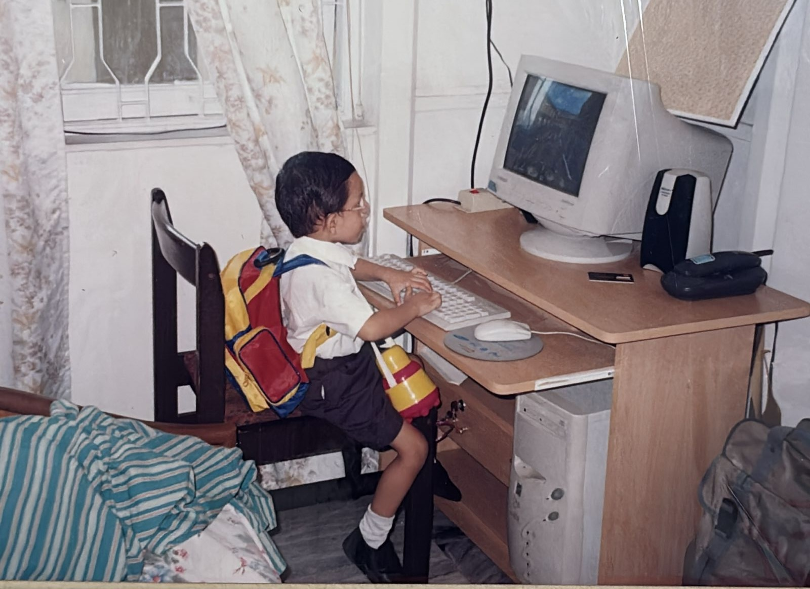
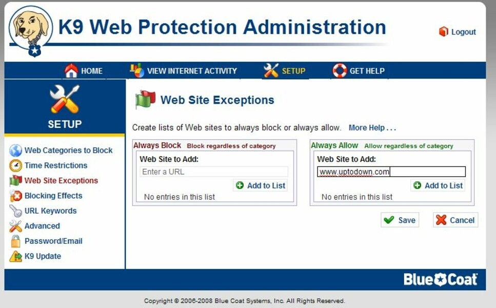

I'm *Giridhar Balachandran*. My friends call me GiriB, Giri, Jordi. 

I’ve basically grown up with computers. My mom still says I’m “Y2K compliant” because she was fixing the Y2K bug while pregnant with me. (Yes, that’s the origin story.)

I was that kid, sneaking in 30 minutes of Road Rash and <a href="https://store.steampowered.com/app/2229850/Command__Conquer_Red_Alert_2_and_Yuris_Revenge/">Red Alert II</a> after school which was pure dopamine.

My first programming experience was with HTML. I convinced my parents to get me a “Programming with HTML” book, since the only rule was to read for 30 minutes before bed and my choice of book was clear. From there, I just kept building.

My uncle one day installed K9 Protection to “keep me safe.” Translation: no YouTube. So I got scrappy. Learned about keystroke logging, dug up some C code, ran it, and waited for him to type the password. Boom—barriers down. This was my first real “problem solved with software.”

When I realized I wanted to work in Software was after my first Google search. It was magical. Google used to show how many seconds it took to find something in the right corner - 0.000034323 seconds. For a kid who didn't understand CPUs, networking or even how the internet worked, that number was still magical to me. I wanted to work for Google. 

These are some of the experiences that have shaped me to the person I am today. Still curious, still learning everyday. 

---

*Reach out if you want to talk about building products in AI, enterprise software or even a quick debate on the UFC GOAT.*
